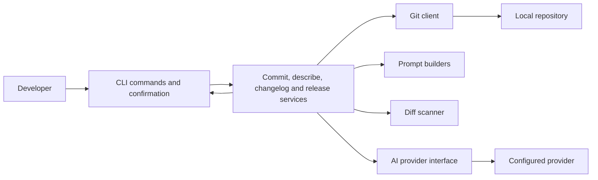

# GitX: AI assistance around an explicit Git workflow

## Problem

Writing commit messages, release notes, and pull request descriptions requires translating
repository changes into useful context. GitX uses an AI provider to help with that work,
while keeping the Git operations and the user's confirmation in separate code paths.

## Architecture



The diagram summarizes the responsibilities in the current source; it is not a latency
measurement or a claim about production adoption.

## Decisions and tradeoffs visible in the implementation

- **Git and AI are separate dependencies.** Services receive Git and AI interfaces rather
  than embedding provider-specific calls in the command handlers. This keeps orchestration
  testable, at the cost of additional interfaces and adapters.
- **Diff selection is explicit.** The commit command supports staged, unstaged, and automatic
  selection. Automatic mode tries staged changes first and otherwise uses tracked unstaged
  changes. The convenience of automatic selection makes the CLI's displayed diff important
  during review.
- **Generation is separate from confirmation.** The service generates a proposed message;
  the CLI handles presentation and confirmation before a commit. Generated text still needs
  review for accuracy.
- **AI providers are configurable.** A provider factory makes switching possible without
  changing the command interface. Providers still differ in output quality, availability,
  latency, and usage cost; the abstraction does not eliminate those differences.

## Read the implementation

- [Commit command and interactive flow](../internal/cli/commit.go)
- [Commit generation service](../internal/services/commit_service.go)
- [AI provider factory](../internal/ai/factory.go)
- [Diff scanner](../internal/security/scanner.go)
- [Git client implementation](../internal/git)
- [Service tests](../internal/services/commit_service_test.go)

## Try it

From a configured installation in a Git repository:

```bash
gitx describe --staged
gitx commit --staged
```

The second command enters an interactive generation and confirmation flow. See the
[README](../README.md) for setup and provider configuration. No generated output or adoption
metrics are presented here as measured results.

## Status

These notes describe source-level architecture and existing test coverage. Provider-backed
commands require configuration and network access. End-to-end generation performance and
adoption have not been benchmarked in these notes.
